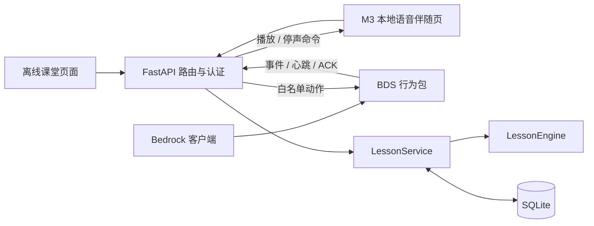

# 架构与数据流

## 模块边界

M1 是独立可运行的浏览器课堂。M3 的游戏场景由 BDS 执行，伴随页只负责本地声音和家长控制。
两种模式复用课程引擎，但已绑定 BDS 的课次不能再接受 Mock 游戏通道输入。

## 后端职责

| 模块 | 单一职责 |
| --- | --- |
| `models.py`、`requests.py`、`responses.py` | 严格输入输出模型与动作白名单 |
| `main.py` | 组装应用、公共路由与默认访问控制 |
| `service.py` | 校验来源、协调事务、调用课程引擎 |
| `lesson_engine.py` | 根据当前状态分发教学事件 |
| `controls.py` | 开始、暂停、重听、帮助、跳过与退出 |
| `task_flow.py` | 进入任务、完成任务与签发下一步 |
| `exposure_engine.py` | 有效呈现、独立/辅助正确和迁移证据 |
| `storage.py` | SQLite 快照、事件收据和命令队列 |
| `bedrock.py`、`bedrock_security.py` | 匿名世界绑定、探针与 BDS 凭据隔离 |
| `bedrock_lesson.py`、`bedrock_presence.py` | M3 动作、视觉租约、伴随音频和耗时统计 |

## 一次事件如何处理

1. 路由限制事件类型并验证来源认证。
2. 写事务内检查课次与世界绑定。
3. 相同事件 ID 和正文返回原收据；同一 ID 换正文返回冲突。
4. 校验玩家、当前任务、来源序号及未来时间范围。
5. 引擎执行有效状态转移，计算证据并签发白名单动作。
6. 状态、事件结果和待执行动作一起提交。

SQLite `BEGIN IMMEDIATE` 串行化写事务。断线重发不会因重做一次请求而重复签发奖励。
来源序号相互独立；M3 游戏内控制与选择共享 game 序号，伴随页控制使用 control，媒体回执使用 voice。

## 一次动作如何处理

BDS 获取包含课次状态和命令的快照，校验动作归属、类型和目标，再持久化执行意图。
随机布局先保存后执行，重启不会因为重投而重新随机。
成功效果写入执行记录后发送 ACK；丢失 ACK 时重发确认。

Minecraft 世界修改与 SQLite 不是同一个事务。门和装饰使用固定坐标的状态赋值，
用于覆盖“效果发生，但执行记录还没保存”的间隙。瞬时声音和粒子在这类间隙仍可能重播。
动态属性的断电持久性取决于 Minecraft 存档，不能宣称所有世界操作恰好执行一次。

## 音画协作

- 视觉回执绑定当前视觉 command_id；随机布局完成不能由单纯可见替代。
- BDS 以角色在线、距离、视向和方块遮挡检查可见性，并发送短期心跳。
- 伴随页只有在任务和视觉证据满足条件时播放本地 WAV。
- 真实媒体 ended 携带播放开始时的可见性代次；失联、不可见或换场景会使旧代次失效。
- 暂停立即停止本地媒体，服务端取消旧音频；恢复时按状态重新签发播放。

服务器几何检查无法检测客户端窗口遮挡、最小化或孩子注意力。实际显示和操作仍需实机校准。

## 教学结果

H0、首次正确选择及已确认随机布局共同构成独立正确；使用提示、先错后对和缺少布局证据分别记录。
游戏剧情状态与词汇证据分开保存。首课不自动认定稳定掌握，跨日期复核安排在 M5。
可选口语不做发音评分；当前版本没有录音与真实 STT。
